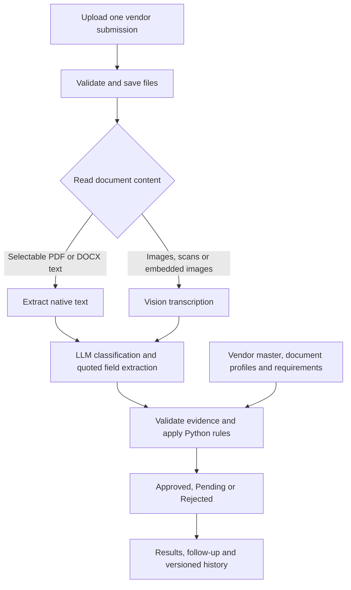

# Vendor onboarding

## Run the project

**Project report and demonstration:** [View the project PDF and Streamlit demo video on Google Drive](https://drive.google.com/drive/folders/1EbjrdmE8AYIUr8v_T9CIMNgoiYA7fyg0?usp=drive_link).

### 1. Install the dependencies

Use Python 3.11 or later. Run the following commands in PowerShell from the project root, where `main.py` and `requirements.txt` are located:

```powershell
python -m venv .venv
.\.venv\Scripts\python.exe -m pip install -r requirements.txt
```

These commands use the virtual environment directly; activating it is optional. A local GPU is not required because model inference runs through Groq.

### 2. Configure the application

Create `.env` from the example only if it does not already exist:

```powershell
if (!(Test-Path .env)) { Copy-Item .env.example .env }
```

Open `.env` and enter your Groq API key:

```dotenv
GROQ_API_KEY=your_groq_api_key
GROQ_TEXT_MODEL=openai/gpt-oss-120b
GROQ_VISION_MODEL=qwen/qwen3.8-27b
DATABASE_PATH=data/runtime/onboarding.sqlite3
UPLOAD_DIR=data/runtime/uploads
MAX_FILE_MB=15
MAX_BATCH_MB=45
```

Model access and API quotas depend on the Groq account. Keep `.env` private and use `.env.example` for sharing configuration names without credentials.

The repository includes the vendor master, document profiles, requirements and case definitions under `data/`. Keep these source files in place.

### 3. Generate the demonstration documents

For the first generation:

```powershell
.\.venv\Scripts\python.exe scripts/make_dataset.py
.\.venv\Scripts\python.exe scripts/check_dataset.py
```

If `data/generated/` already exists and you want to replace it:

```powershell
.\.venv\Scripts\python.exe scripts/make_dataset.py --overwrite
.\.venv\Scripts\python.exe scripts/check_dataset.py
```

Generation is needed for the included demonstration cases. It is not required when reviewing documents received from another source. Do not regenerate the dataset for every app launch.

### 4. Run the tests

```powershell
.\.venv\Scripts\python.exe -m pytest tests -q
```

### 5. Start the website

```powershell
.\.venv\Scripts\python.exe -m streamlit run main.py
```

Open the local URL printed in the terminal, normally [http://localhost:8501](http://localhost:8501).

The homepage opens directly to document upload. Select all initial documents from `data/generated/C02/`, click **Check documents**, and review the result. C02 is an existing approved vendor scenario and is expected to be **Approved** when extraction is complete and consistent.

For subsequent launches, only the Streamlit command is needed if configuration and dependencies are already set up. Press `Ctrl+C` in the terminal to stop the server.

## Contents

- [Project overview](#project-overview)
- [How the application works](#how-the-application-works)
- [What the application checks](#what-the-application-checks)
- [Streamlit application features](#streamlit-application-features)
- [Data stores and configuration](#data-stores-and-configuration)
- [Synthetic dataset](#synthetic-dataset)
- [Project structure and file responsibilities](#project-structure-and-file-responsibilities)
- [Maintenance and verification](#maintenance-and-verification)
- [Scope and practical limits](#scope-and-practical-limits)
- [Technology stack and references](#technology-stack-and-references)

## Project overview

Vendor onboarding helps an operations or procurement team review documents received from a vendor. The operator uploads the evidence, and the application extracts the vendor's details, identifies an existing vendor where possible, applies explicit checks, and presents a decision with reasons and next steps.

One review request can contain a combined PDF or multiple PDF, PNG, JPEG and DOCX files. The operator does not need to copy a JSON form, enter a vendor ID, or manually transcribe the vendor's identity and bank information.

The application produces three business outcomes:

| Decision | Meaning in this project |
| --- | --- |
| **Approved** | Required evidence passed the configured checks against one existing approved vendor record. |
| **Pending** | Evidence needs correction, completion or manual review, or the vendor requires procurement verification. |
| **Rejected** | Reliable document identifiers match an internally blocked vendor record under the demonstration policy. |

A new vendor with a complete document set remains **Pending** until procurement completes its verification. Completing automated document checks does not automatically create or approve a vendor-master record.

## How the application works



### File intake

The upload layer checks supported extensions, nonempty content, file sizes and recognizable file signatures. It assigns a submission ID, saves uploaded copies with unique filenames, and records file metadata and SHA-256 hashes.

The file-count limit applies to the files uploaded in a single batch. A combined document is one file even when it contains several evidence types. The application expects each submission to concern one vendor; it does not split a mixed-vendor bundle into independent onboarding requests.

### Reading and transcription

PDFs with selectable text are read using PyMuPDF. Scanned pages, images and PDF pages containing substantial raster content are transcribed through the configured Groq vision model.

DOCX processing reads paragraphs, tables, text boxes, hyperlinks, headers and footers. Embedded document images are transcribed separately. Each text block retains a file and page or section locator.

Recognized large diagonal watermarks are separated from native PDF field lines so they do not become part of names, identifiers or addresses. Real field values containing words such as `Demo` are preserved. The generated dataset uses clear document bodies without the diagonal background watermark.

### Document classification and field extraction

The text model classifies the evidence as PAN proof, GST registration, bank proof, business registration, declaration or other content. One page can contain multiple document entries.

For extracted fields, the model returns a value, a source quote and a confidence score. The application validates the response structure and requires the quote and value to be supported by the supplied text. Missing, unreadable or unsupported fields do not become trusted evidence.

The two model roles are deliberately separate:

| Model role | Configuration | Responsibility |
| --- | --- | --- |
| Text model | `GROQ_TEXT_MODEL` | Classify documents, extract quoted fields and draft issue-specific follow-ups. |
| Vision model | `GROQ_VISION_MODEL` | Transcribe images and scanned document content into text. |

The models provide evidence and wording. **Python rules determine the decision.**

### Automatic vendor matching

The application compares reliable PAN and GSTIN values with the current vendor-master CSV. A match through either identifier can identify an existing vendor. A name by itself is not used to establish a master-record match.

The matching result distinguishes:

- One matching record.
- Multiple possible records requiring identity review.
- No matching record.
- Missing or invalid identity information that prevents a useful match.

Document values are not filled from master data. For example, matching through a GSTIN does not make a missing PAN document count as present.

### Checks and decision

The rules evaluate document completeness, field readability, identifier structure, relationships between fields, consistency across documents, and differences from the matched vendor record.

A rejection condition takes precedence. Otherwise, any unresolved check keeps the submission Pending. Approval requires the remaining checks to pass against an existing approved record.

### Follow-up and storage

The result includes actionable reasons. For nonapproved submissions, a follow-up message explains the missing evidence, corrections or internal review needed. Reviewers can edit and save the latest completed follow-up in the audit history.

The application provides the message on screen for copying; it does not send email.

## What the application checks

### Required evidence

| Vendor category | Core documents | GST handling |
| --- | --- | --- |
| Company | PAN proof, bank proof and business registration. | GST certificate is required when GST evidence exists or the matched master contains a GSTIN. |
| Sole proprietor | PAN proof and bank proof. | A new vendor without GST evidence must supply an explicit written non-registration explanation. |
| Individual | PAN proof and bank proof. | The same evidence-based GST handling applies. |

An existing approved vendor whose master record has no GSTIN can pass without a newly supplied non-registration statement, provided the other checks pass. An absent GSTIN alone is not accepted as a new vendor's written explanation.

The default document profiles require these fields within the relevant evidence entries:

| Document type | Required extracted fields |
| --- | --- |
| PAN proof | Legal name and PAN. |
| GST registration | Legal name and GSTIN. |
| Bank proof | Account holder, account number and IFSC. |
| Business registration | Legal name and registration number. |

At the submission level, legal name, PAN, account holder, bank account and IFSC form the core extracted-field requirements. Address is checked for consistency and master-record differences whenever it is extracted; it is not a mandatory core field in the supplied requirements configuration.

### Validation parameters

| Parameter | Implemented check | Typical outcome when unresolved |
| --- | --- | --- |
| Document presence | Required evidence types exist for the resolved vendor category. | Pending with the missing document listed. |
| Document readability | Required fields are present in reliable evidence. | Pending with a request for clearer or complete evidence. |
| Source support | Extracted values and quotes are supported by source text. | Pending for extraction or source review. |
| Classification confidence | Document confidence must be at least `0.65` to participate as reliable evidence. | Pending for uncertain classification. |
| Field confidence | Field confidence must be at least `0.60` to participate as reliable evidence. | Pending for uncertain fields. |
| Confidence validity | Scores must be finite numbers between 0 and 1; booleans and malformed scores are rejected. | Processing or extraction review. |
| PAN structure | Five letters, four digits and one final letter. | Pending for corrected identity evidence. |
| PAN holder category | Holder-category character is consistent with the resolved company or individual/proprietor route. | Pending for identity review. |
| GSTIN structure | Fifteen-character structural pattern. | Pending for corrected GST evidence. |
| PAN–GSTIN relationship | The PAN embedded in a valid GSTIN agrees with the PAN evidence. | Pending for consistent tax documents. |
| IFSC structure | Four letters, the digit `0`, and six alphanumeric characters. | Pending for corrected bank evidence. |
| Bank account structure | Between 9 and 18 digits. | Pending for corrected bank evidence. |
| Account-holder relationship | The account holder agrees with the legal name or an established account-holder relationship in the matched master. | Pending for supporting linkage evidence. |
| Cross-document consistency | PAN, GSTIN, bank details, legal name, account holder and address do not contain conflicting reliable values. | Pending with the conflicting values retained for review. |
| Master comparison | Extracted PAN, GSTIN, legal name, address and bank details agree with the matched record. | Pending for separate verification of changes. |
| Existing vendor status | The matched record is approved and is not blocked. | Pending or Rejected according to the record and policy. |
| New vendor | No existing record is matched. | Pending for procurement verification. |
| Blocked vendor | Reliable identifiers match an internally blocked record. | Rejected. |
| Extraction/read failures | Every active file can be read and processed sufficiently. | Pending or a failed processing stage requiring review. |

Confidence scores are model-provided indicators, not calibrated probabilities of authenticity.

### Identifier patterns

```text
PAN:          ^[A-Z]{5}[0-9]{4}[A-Z]$
GSTIN:        ^[0-9]{2}[A-Z]{5}[0-9]{4}[A-Z][1-9A-Z]Z[0-9A-Z]$
IFSC:         ^[A-Z]{4}0[A-Z0-9]{6}$
Bank account: ^[0-9]{9,18}$
```

Identifier values are normalized for whitespace and case before comparison. Names and addresses are normalized for case, punctuation and spacing; common company-suffix variants are also handled. Address comparison is not a semantic address-resolution service: abbreviations, omitted components or OCR errors can still require review.

Registration numbers are extracted and checked for presence through the document profile. The current application does not implement a separate registration-number authenticity or registry-status check. Contact name, email and phone are optional extracted details and are not required for the decision.

### Document profiles

`data/document_profiles.csv` defines document names, expected headings, field-label cues and required fields. A profile matches when a title cue is present or sufficient field-label cues are found.

This accommodates different layouts without requiring a fixed reference PDF. It helps identify unfamiliar or incorrect attachments; it does not establish that a document is genuine or government-issued.

## Streamlit application features

### Direct upload homepage

The homepage presents the upload control and **Check documents** action immediately. The operator can submit a combined PDF or several supported files without opening a separate creation page or completing a vendor-details form.

### Sidebar history

The sidebar lists review attempts using labels such as `Company name (1)` and `Company name (2)`. Each entry has a status icon and a compact status caption. Clicking it opens that attempt's saved details.

History can be searched by company or submission ID and filtered by status. It covers attempts belonging to the 200 most recently updated submissions. Earlier attempts retain their own status even when a later correction is approved.

Attempt numbers belong to one submission ID. Starting a separate **New review** creates a separate submission; the same company can therefore have more than one independent entry numbered `(1)`.

### Live processing stages

A live status panel reports stages such as reading, classification, extraction, checking, decision and follow-up drafting. The same stages are recorded in the review's timeline.

**Processing complete** means the pipeline finished. The business decision can still be **Pending** because documents, corrections or procurement verification are outstanding.

### Decision and missing-document summary

The detail page shows the decision prominently, followed by missing-document or information messages and the follow-up. Users can understand what needs attention before inspecting the lower-level evidence.

### Context-sensitive follow-up

The message reflects the actual outstanding checks rather than using one generic response for every Pending case. It can request missing bank proof, consistent PAN/GSTIN evidence, clearer files or verification of changed details.

When procurement verification is the sole unresolved issue for a new vendor, the application uses this fixed message:

> All required documents have passed the automated checks. No matching vendor record was found in our database, so this submission is being treated as a new vendor. Final approval is pending an in-person meeting and verification by the procurement team.

This wording is not used when missing, conflicting, invalid or unreadable evidence remains. The on-screen message can be copied, edited and saved for the latest completed Pending or Rejected attempt. Earlier attempts remain read-only. A fallback message is available when model drafting fails.

### Extracted vendor details

The page displays the legal name, resolved vendor type, PAN, GSTIN, account holder, IFSC, address and masked bank account. It also explains how vendor type and master matching were resolved.

Unavailable identifiers are distinguished from a completed search with no matching record. A missing document does not itself establish that the vendor is absent from the database.

### Comparison with the registered record

The comparison section places extracted document values beside the vendor-master snapshot used during that attempt. Fields are marked as matching, differing, not extracted or conflicting.

For conflicts, the page shows each extracted candidate, its source file/page, and whether it agrees with the stored record. It does not hide competing values behind a blank field or silently choose the value that matches the master.

### Evidence and source quotes

The **Extracted evidence** tab groups evidence by document type and source location. Expanders expose classification confidence, read method, document-profile results, extracted fields and source quotes. Superseded evidence is marked separately from active evidence.

Quotes support reviewer inspection; a quoted value can still be wrong because of transcription or document content. Reviewers can compare the extraction with the source preview.

### Document previews and downloads

The **Source files** tab supports page selection for PDF previews, image display, DOCX text/table content and supported embedded images. Original uploaded files can be downloaded.

### Review timeline and decision checks

The timeline records processing stages and messages. The **Decision checks** tab shows individual checks with their result, next action and source references, making it possible to inspect why the overall status was assigned.

### Corrections and linked attempts

Use **Upload a correction / new version** from the latest result:

1. Upload missing evidence, or select earlier files that the new evidence replaces.
2. Submit the correction to create the next attempt under the same submission ID.
3. Review the updated decision while preserving the earlier result and originals.

Adding a file does not automatically invalidate earlier conflicting evidence. Incorrect or unreadable files must be selected explicitly for replacement. Replacing a combined PDF requires supplying all evidence that the combined file previously contained.

Uploads may be left empty when reprocessing retained documents, provided at least one active file remains. This is useful after an extraction-code update. Saved results are not silently recalculated when code or master data changes.

### Bank-detail display controls

Bank accounts are masked in normal summaries and comparison views. A separate reviewer expander exposes the full uniquely extracted account number when needed. Masking is a display feature; original documents and stored evidence still contain sensitive values.

### Persistent history

Closing the browser or restarting Streamlit does not remove saved reviews or uploaded copies. The application reconstructs history from SQLite. Streamlit's cache-clearing action does not delete these project files.

The interface uses text and container components for history and comparisons rather than Pandas dataframe rendering, avoiding that rendering path's native-library dependency during normal use.

## Data stores and configuration

The application uses two distinct stores: a reference vendor master and an operational review database.

### Vendor master: `data/vendor_master.csv`

The CSV is the authoritative comparison source for the current review. It is read again for each processing run; an XLSX export is not automatically read by the app.

The supplied master contains five synthetic records:

| Vendor ID | Vendor | Category | Master status |
| --- | --- | --- | --- |
| V100 | Northstar Office Supplies Private Limited | Company | Approved |
| V101 | Meera Rao | Sole proprietor | Approved |
| V102 | Blocked Demo Trading | Company | Blocked |
| V103 | Seabrook Instruments Private Limited | Company | Approved |
| V104 | Rohan Shah | Sole proprietor | Approved |

The columns are:

```text
vendor_id, legal_name, vendor_type, pan, gstin, account_holder,
bank_account, ifsc, address, status, version
```

`version` here belongs to the master record. It is separate from a submission's review-attempt number. GSTIN can be blank for an unregistered vendor; missing contact email or phone does not imply that a master record is incomplete under this schema.

To import a reviewed replacement master:

```powershell
.\.venv\Scripts\python.exe scripts/import_vendors.py path/to/reviewed_vendor_master.xlsx
```

CSV inputs are also supported. Keep identifiers and bank accounts as text to preserve leading zeros. Formula cells should be replaced with reviewed values. The import validates the input and publishes a complete replacement CSV; it is not an automatic merge or an approval action performed by the web app.

### Review database: `data/runtime/onboarding.sqlite3`

SQLite stores operational state and audit history:

| Table | Stored information |
| --- | --- |
| `submissions` | Submission identity, timestamps and latest attempt number. |
| `versions` | Each attempt's stage, status, metadata, extracted evidence, checks, follow-up and processing error. |
| `files` | Original/stored filenames, type, size, hash and links to a submission and attempt. |
| `events` | Processing-stage messages and recorded reviewer actions such as saved follow-up edits. |

Saved extraction includes the matched master-record snapshot and the requirements/profile snapshots used for the review. This allows a historical decision to be inspected even after the live CSV changes.

The database uses foreign-key checks, write transactions and concurrency guards for linked versions. Stale correction forms cannot silently overwrite a newer attempt. The pipeline claims queued work before processing it to avoid processing the same attempt twice through the normal run path.

The audit history supports traceability within this application; it is not an independently tamper-proof audit service.

### Uploaded files: `data/runtime/uploads/`

Original uploaded copies are grouped by submission ID and saved under unique filenames. SQLite keeps their original names for display. The files remain available for history and previews, including originals that were superseded by a correction.

SHA-256 hashes describe file contents for traceability; a hash does not prove document authenticity.

Back up the entire `data/runtime/` directory while the app is stopped to preserve both SQLite history and its referenced uploads. Regenerating `data/generated/` does not replace files already copied into runtime storage.

### Requirements: `data/requirements.json`

This file defines the workflow, country context, per-batch file count, required extracted fields and documents by vendor type. `policy_notes` explain the rules; changing those descriptions alone does not change executable behavior.

The upload count is controlled by `max_files`. For a four-file intake limit, set:

```json
"max_files": 4
```

The supplied configuration reviewed during development used `12`; the actual local value is authoritative. The application checks the newly uploaded batch, rather than the cumulative number of retained files across all review attempts.

### Limits and environment settings

| Setting or constraint | Location | Behavior |
| --- | --- | --- |
| Groq API credentials and models | `.env` | Used for extraction, transcription and message drafting. |
| Database location | `DATABASE_PATH` | Defaults to `data/runtime/onboarding.sqlite3`. |
| Uploaded-file location | `UPLOAD_DIR` | Defaults to `data/runtime/uploads`. |
| Maximum file size | `MAX_FILE_MB` | Default is 15 MiB per newly uploaded file. |
| Maximum batch size | `MAX_BATCH_MB` | Default is 45 MiB per newly uploaded batch. |
| Maximum upload count | `data/requirements.json` → `max_files` | Configurable positive integer. |
| Streamlit uploader ceiling | `.streamlit/config.toml` | May impose an additional per-file ceiling; keep it aligned with the application limit. |
| PDF pages | `app/documents.py` | Up to 30 pages per PDF. Password-protected PDFs must be unlocked first. |
| DOCX images | `app/documents.py` | Up to eight embedded images per DOCX. |
| DOCX expanded package | Upload and reading code | Bounded entry count and an expanded-size ceiling of 100 MiB. |
| Text extraction block | `app/llm.py` | Up to 25,000 characters per block; larger blocks require splitting or manual handling. |

Relative storage paths resolve from the project root. `main.py` must use `Path(__file__).resolve().parent` because it is located at that root.

## Synthetic dataset

### What the dataset represents

The repository defines **20 synthetic submission scenarios**, not 20 approved vendors or 20 distinct master records. Some scenarios reuse an existing vendor to exercise changes or blocking; others represent new vendors.

The dataset tests three dimensions:

- **Business conditions:** existing/new vendors, missing evidence, conflicts, changed banking details and blocked records.
- **Input formats:** native PDFs, combined PDFs, scanned PDFs, PNG/JPEG images and DOCX text or embedded images.
- **Workflow behavior:** initial review, correction, evidence replacement and linked history.

### How the files are created

1. `data/fixtures/cases.json` supplies vendor values, document types, formats, deliberate overrides and correction evidence.
2. `scripts/make_dataset.py` validates these definitions and prepares the values for each case.
3. `scripts/document_designs.py` draws the document-specific layouts and fields.
4. The generator creates native PDFs, raster images, scanned combined PDFs or DOCX evidence according to each case definition.
5. It writes the case manifest and spreadsheet copies of the current master and profiles.
6. `scripts/check_dataset.py` checks the generated files, page counts, bounds, content expectations and readable package structure.

The generator uses staged output and explicit `--overwrite` handling to replace an existing dataset. It does not modify runtime review history or automatically submit cases to the web app.

The layout variations provide headings and fields appropriate to PAN, GST, banking and registration evidence. The diagonal background watermark has been removed; a small footer still identifies the documents as demonstration evidence without overlapping field values.

### Generated outputs

| Output | Purpose |
| --- | --- |
| `data/generated/C01/` … `C20/` | Uploadable documents for each scenario. |
| `data/generated/manifest.json` | Initial and correction-file paths associated with each case. |
| `data/generated/vendor_master.xlsx` | Spreadsheet copy of the vendor master. |
| `data/generated/document_profiles.xlsx` | Spreadsheet copy of the document profiles. |
| `data/generated/layout_report.json` | File/layout-check results written by the checker. |
| `data/generated/_previews/` | Optional contact sheets created with `--previews`. |

There is no manual `form.json` entry step in the current workflow. The case JSON is generator input, not vendor evidence submitted to the app.

### Scenario catalogue

These are the expected business outcomes with correct, sufficiently reliable extraction:

| Case | Scenario | Expected result |
| --- | --- | --- |
| C01 | Complete new company. | Pending: procurement verification. |
| C02 | Existing approved company matched from identifiers. | Approved. |
| C03 | All required evidence in one PDF. | Pending: new vendor verification. |
| C04 | Evidence split across PNG/JPEG and PDF. | Pending: new vendor verification. |
| C05 | Bank proof missing. | Pending: missing bank evidence and fields. |
| C06 | Harmless company-suffix variation. | Pending: new vendor verification. |
| C07 | PAN document differs from the PAN embedded in GSTIN. | Pending: tax-identity inconsistency. |
| C08 | Legal names conflict across documents. | Pending: conflicting names. |
| C09 | Existing vendor submits changed bank details. | Pending: independent bank-change verification. |
| C10 | Identifiers match a blocked vendor. | Rejected. |
| C11 | Bank-account evidence is unreadable. | Pending: readable replacement required. |
| C12 | Unrelated invoice supplied instead of bank proof. | Pending: correct bank proof required. |
| C13 | Malformed PAN and GSTIN structures. | Pending: corrected identifiers required. |
| C14 | Existing sole proprietor with no GSTIN in the master. | Approved. |
| C15 | New sole proprietor without GST evidence or a written explanation. | Pending: GST explanation and procurement verification. |
| C16 | Existing approved company without a manually entered vendor ID. | Approved. |
| C17 | Bank proof embedded as an image in DOCX. | Pending: new vendor verification. |
| C18 | Correction supplies initially missing bank proof. | Pending initially; remains Pending for new vendor verification after correction. |
| C19 | Registration evidence supplied in a DOCX table. | Pending: new vendor verification. |
| C20 | All evidence supplied in a scanned combined PDF. | Pending: new vendor verification. |

The expected outcomes come from `data/fixtures/expected_results.json`. That file is an offline answer key; the running app does not read it to assign decisions. Live OCR/extraction can produce additional review issues, so an expected outcome is not a hardcoded response to a case ID.

### Useful demonstration cases

For a short walkthrough, use **C02** for approval, **C05** for missing evidence, **C07** for cross-document inconsistency and **C09** for a changed bank account. **C10** demonstrates rejection, while **C01** demonstrates the clean-new-vendor procurement handoff.

Use **C03** to show a single combined PDF, **C20** to exercise vision transcription, and **C18** to demonstrate linked corrections and historical attempts.

### Optional preview sheets

```powershell
.\.venv\Scripts\python.exe scripts/check_dataset.py --previews
```

The checker validates files and layouts; it does not certify live model extraction accuracy. Image and scan checks do not independently prove that OCR will recover every field correctly.

## Project structure and file responsibilities

### Application entry point

| File | Responsibility |
| --- | --- |
| `main.py` | Root Streamlit entry point. Builds the direct-upload homepage, sidebar history, processing display, review details, follow-ups, comparisons, previews and correction flow. |

### Application modules: `app/`

| File | Responsibility |
| --- | --- |
| `app/__init__.py` | Marks `app` as a Python package. |
| `app/upload.py` | Validates files, applies upload limits, saves originals, records metadata and handles explicit file replacement for corrections. |
| `app/documents.py` | Reads PDF/DOCX text, separates recognized watermark overlays and transcribes images or scans through vision. |
| `app/llm.py` | Defines the extraction schema, requests classified source-quoted fields, validates model output and creates follow-up messages. |
| `app/profiles.py` | Loads and validates the document-profile CSV and assesses heading/label matches. |
| `app/rules.py` | Normalizes evidence, matches PAN/GSTIN, checks completeness and consistency, compares master values and determines the decision. |
| `app/pipeline.py` | Coordinates reading, classification, extraction, checking, decision and follow-up stages; preserves source metadata and processing failures. |
| `app/db.py` | Manages SQLite submissions, versions, file records and events; reads and validates the current vendor-master CSV. |

### Source data: `data/`

| File | Responsibility |
| --- | --- |
| `data/vendor_master.csv` | Current authoritative vendor comparison records. |
| `data/document_profiles.csv` | Document-type headings, labels, display names and required fields. |
| `data/requirements.json` | Required evidence and extracted-field configuration, file-count limit and explanatory policy notes. |
| `data/fixtures/cases.json` | Twenty synthetic scenario definitions and any correction evidence. |
| `data/fixtures/expected_results.json` | Offline expected decisions, matched vendor IDs and required issue codes. |

`data/generated/` is created by the dataset generator. `data/runtime/` is created during application use. The seed scripts can recreate the two default CSVs; they do not recreate the fixture JSON files or `requirements.json`.

### Utilities: `scripts/`

| File | Responsibility |
| --- | --- |
| `scripts/make_dataset.py` | Creates case documents, the manifest and XLSX copies from the fixture definitions. |
| `scripts/document_designs.py` | Draws document layouts, labels and values, including the small demo footer. Shared by generated PDF and image-based evidence. |
| `scripts/check_dataset.py` | Validates generated files and expected document content; optionally creates contact sheets. |
| `scripts/import_vendors.py` | Imports a reviewed CSV/XLSX master after schema and value validation, using an atomic CSV write. |
| `scripts/seed_vendor_master.py` | Recreates the five default vendor rows in the vendor-master CSV. |
| `scripts/seed_document_profiles.py` | Recreates the default document-profile CSV. |

### Tests: `tests/`

| File | Responsibility |
| --- | --- |
| `tests/test_rules.py` | Checks document-only matching, required evidence, cross-field conflicts, master changes, blocked vendors and expected scenario outcomes. |
| `tests/test_profiles.py` | Checks profile matching and malformed profile configuration. |
| `tests/test_app_workflow.py` | Checks extraction validation, readers, upload metadata, pipeline persistence, corrections, history and follow-up editing using isolated state and mocked external responses. |

### Setup and repository files

| File | Responsibility |
| --- | --- |
| `requirements.txt` | Python dependencies for the app, document generation, imports and tests. |
| `.env` | Local credentials, model choices, paths and upload-size settings. Keep private. |
| `.env.example` | Shareable configuration template with no real API key. |
| `.streamlit/config.toml` | Streamlit appearance and framework-level settings such as the upload ceiling. |
| `Dockerfile` | Optional container build/run definition. Its entry point must use the root `main.py`. |
| `.dockerignore` | Excludes unnecessary or private files from the Docker build context. |
| `.gitignore` | Excludes credentials, runtime artifacts and other local outputs from version control according to its patterns. |
| `README.md` | Setup, architecture, rule definitions, features, dataset catalogue and operating guidance. |

## Maintenance and verification

### Recreate missing default CSVs

```powershell
.\.venv\Scripts\python.exe scripts/seed_vendor_master.py
.\.venv\Scripts\python.exe scripts/seed_document_profiles.py
```

These scripts require `--overwrite` to replace existing CSVs. Overwriting restores the demo defaults rather than preserving a customized vendor list.

### Change requirements or rules

- Edit `data/requirements.json` for supported requirement fields and upload count.
- Edit `data/document_profiles.csv` for document cues and required profile fields.
- Update `app/rules.py` and the tests when changing executable decision policy.
- Import a reviewed vendor master when reference vendor values change.
- Reprocess retained evidence as a new attempt to apply changes to an existing submission.

Changing a descriptive `policy_notes` entry, an XLSX export, or a fixture's expected result does not directly change the running application's decision logic.

### Test interpretation

The test suite contains parameterized checks, so its test count is larger than the 20 scenario definitions. Tests validate the application logic and controlled failure paths. Model responses are mocked in workflow tests to keep them repeatable and independent of API quotas.

Development verification also included supplied C02 PDF reading, source-quote validation, conflict rendering, sidebar navigation and UI execution with Pandas imports blocked. These checks do not establish an end-to-end accuracy score for live Groq extraction.

### Regeneration and existing history

`make_dataset.py --overwrite` replaces the generated demo files. It does not update previous uploads, extracted results or saved decisions in SQLite.

After regeneration, use **New review** and upload the new files. To keep the same submission history, use the correction action and explicitly replace the earlier files with the regenerated versions.

### Troubleshooting

| Symptom | What to check |
| --- | --- |
| No generated case folders | Run `scripts/make_dataset.py` once; retain the source JSON/CSV files. |
| Generator says output already exists | Use `--overwrite` only when you intend to replace the generated dataset. |
| Missing Groq key or model error | Check the root `.env`, exact model IDs, account access, quota and network connection. |
| C02 is Pending | Inspect individual checks, extracted values/source quotes and the master comparison. The expected answer key does not override OCR/extraction issues. |
| Address is marked conflicting | Read every displayed candidate and its source. Use the source preview to distinguish genuine differences from extraction errors. |
| Corrected evidence does not clear a conflict | Ensure the incorrect earlier file was explicitly selected for replacement. |
| Same company appears twice as `(1)` | These are separate submission IDs. Use the correction flow to create linked attempts. |
| Old decision remains after code/data changes | Saved reviews are snapshots. Create a new attempt to reprocess them. |
| VS Code shows unresolved imports | Select the interpreter from the environment used to install `requirements.txt`. |
| A DLL is blocked by Windows Application Control | This is an environment/policy issue. Review the blocked dependency with the system administrator. The UI avoids Pandas dataframe rendering, but that does not change Windows policy. |
| Container starts the old app path | Ensure the Dockerfile copies root `main.py` and launches it instead of `app/streamlit_app.py`. Supply credentials at runtime and preserve runtime storage if persistence is required. |

## Scope and practical limits

This project provides document completeness, structural validation, internal consistency and vendor-master comparison for an India-focused demonstration. It does not perform live PAN/GST registration lookup, GSTIN checksum verification, bank ownership confirmation, Aadhaar validation, forgery detection or government authentication.

An **Approved** result means the implemented checks passed against an existing approved master record. It does not prove identity, tax registration activity, document authenticity or payment safety. Procurement remains responsible for any external or in-person verification required by the business.

The current application has no login, role-based authorization or procurement-approval button that turns a new vendor into an approved master entry. It stores document copies and extracted evidence locally, without application-level encryption. Uploaded images and relevant text are sent to the configured Groq service for processing. Use controlled demonstration data and appropriate access restrictions when evaluating the project.

## Technology stack and references

| Component | Technology |
| --- | --- |
| Web interface | Streamlit |
| Application and rules | Python |
| Hosted text/vision inference | Groq API |
| Review storage | SQLite |
| Reference data | CSV, with XLSX import/export utilities |
| PDF reading/rendering | PyMuPDF |
| PDF generation | ReportLab |
| DOCX processing | python-docx and XML traversal |
| Image processing | Pillow |
| Spreadsheet processing | openpyxl |
| Environment configuration | python-dotenv |
| Automated checks | pytest |

Official references: [Groq models](https://console.groq.com/docs/models), [Groq vision](https://console.groq.com/docs/vision), [Streamlit file uploader](https://docs.streamlit.io/develop/api-reference/widgets/st.file_uploader), and [Streamlit configuration](https://docs.streamlit.io/develop/api-reference/configuration/config.toml).
